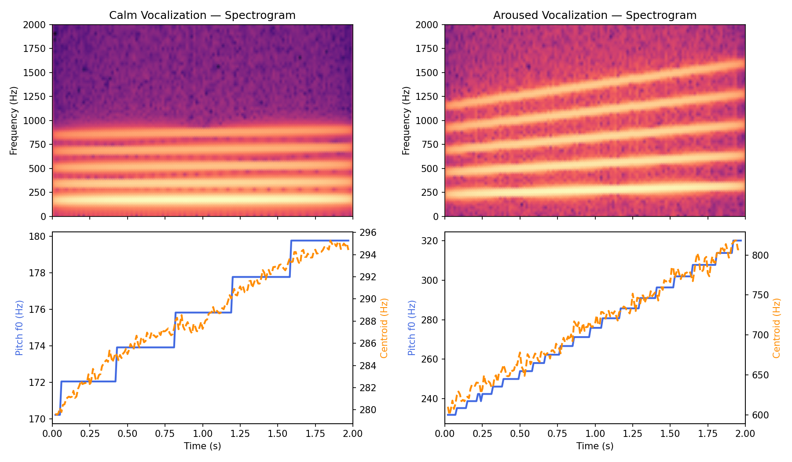

#### Vocal Acoustic Feature & Jitter Sandbox

A small Python project where I created fake voice-like sounds from scratch and wrote simple code to measure their pitch, loudness, brightness, and shakiness. 

#### What I Did, How I Did It & Why It Matters

Instead of using pre-built audio tools that hide how everything works, I built this sandbox using basic math (NumPy and SciPy) so I could see how sound analysis actually works step by step: 

1. **Made a grid that can capture a voice** 

  * **How I did it:** I created a 2-second timeline split into 16,000 steps per second (np.linspace with fs = 16000).
  * **Why it matters:** By the Nyquist rule, sampling 16,000 times a second cleanly captures all frequencies up to 8,000 Hz. That is wide enough to capture the full pitch range of a human voice plus its higher overtones without missing details.
2. **Built a smooth, voice-like sound** 

  * **How I did it:** I looped through 5 harmonic overtones (for h in range(1, 6)), added up the changing pitch step-by-step using np.cumsum() so the wave phase never jumped, and multiplied the wave by a smooth fade-in/fade-out curve (envelope).
  * **Why it matters:** A single sine wave sounds like a robot beep, not a voice. Stacking harmonics mimics real vocal cords, np.cumsum() prevents digital clicks when pitch glides or wobbles, and the envelope keeps the start and end clean.
3. **Used a wide enough window to catch low pitches** 

  * **How I did it:** I slid a 40-millisecond window (640 samples) across the 2-second clip, stepping forward every 10 ms, tapered the edges with np.hanning(), and compared each slice against itself (np.correlate) within human pitch limits (80–400 Hz).
  * **Why it matters:** Because a voice changes constantly, you have to measure it in small slices. A 40 ms slice is wide enough to fit 3 to 5 full sound waves at once, which lets autocorrelation lock onto the true repeating pitch—even for deeper voices.
4. **Measured where the energy sits and how steady the pitch is** 

  * **Spectral Centroid:** 

    * **How I did it:** I converted each slice into frequencies with an FFT (np.fft.rfft) and calculated the weighted average frequency where the energy sits.
    * **Why it matters:** It acts as the "center of gravity" for sound energy—staying low for calm, relaxed voices and climbing higher when vocal tension pushes energy into sharper upper harmonics.
  * **Local Jitter:** 

    * **How I did it:** I converted each frame's pitch (f0) into wave cycle length (1 / f0), measured how much the cycle length changed from one frame to the next (np.diff), and divided by the average cycle length.
    * **Why it matters:** Tiny, rapid timing wobbles between wave cycles are a classic marker of vocal strain or physiological arousal.

#### What It Looks Like

 
 

#### What Happens If the Window Is Too Small?

* **How I did it:** I re-ran the exact same pitch tracker on the calm voice after shrinking the slice size from **40 ms** down to **10 ms**.
* **Why it matters:** When the slice is too short (10 ms), the code loses track of deeper pitches because a single low-pitched wave takes ~6 to 12 ms to finish one cycle—leaving too few complete waves inside the window for the math to measure accurately.
